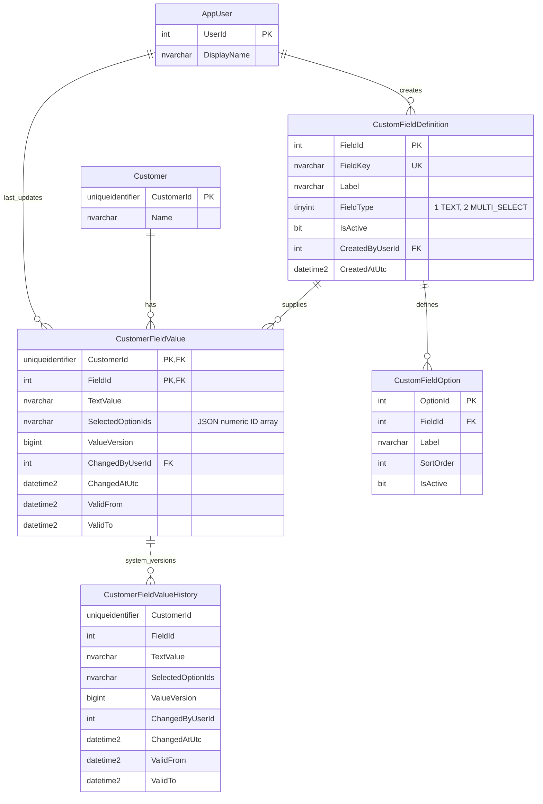

# Customer custom fields

This independent module implements part two of the ERP assignment. It shares a solution and SQL Server 2022 instance with discounts, but has its own database, API and four layered projects. Custom-field values are not connected to discount eligibility.

Endpoint handlers depend on Application's `ICustomFieldService` and `ICustomerService`, rather than repositories. Services own use-case validation, field-type conversion, typed response projection and repository coordination. An `ICurrentActor` interface supplies the trusted actor; its scoped API adapter reads authenticated claims. Handlers retain request binding, authorization and HTTP status/location construction. The required nullable version is expressed by the application input contract's required `ExpectedVersion` property, preserving the distinction between an omitted property and explicit null. SQL remains authoritative for transactional validation, concurrency and history.

Repository construction and DI follow the discount module's pattern: register one singleton `SqlConnectionFactory`, a scoped customer repository, and singleton custom-field Dapper/caching repositories. The cached repositories match the singleton promotion repository pattern in discounts and hold no request state. The singleton is a factory, not a shared open connection; each operation uses `await using` with `OpenAsync(cancellationToken)`, which cleans up failed opens. Connection-string configuration is normalized once and SqlClient connection retries are disabled. Repositories use explicitly typed parameters and stored-procedure `CommandDefinition` objects with cancellation, database-only row types with instance mapping methods, and read-only result collections. Customer-field operations remain single-attempt; the discount module's existing Polly read policy is not applied to customer-field writes.

The dotted history relationship is conceptual: SQL Server manages the history table; it has no separate business primary key or foreign key to the current row. No application audit INSERT or trigger is used.

Definitions apply globally. Profiles begin from definitions and left-join one customer's values, so creating a definition requires no value-row prepopulation. A value row's composite key is (CustomerId,FieldId). User, field and option IDs are integer identities. Customer IDs are regular application-generated `Guid.NewGuid()` values stored as `uniqueidentifier`; no external generator is installed. The Customer primary key is clustered: random insertion locality is an accepted assignment tradeoff. Fixed seed GUIDs support repeatable samples.

FieldType is numeric in SQL (1=TEXT,2=MULTI_SELECT), with checked mapping to public TEXT/MULTI_SELECT names. Text values preserve case and nonempty whitespace; an empty string becomes NULL only after SQL verifies a TEXT field. Multi-select options are normalized rows, but a customer's complete selection is one canonical JSON array of unique ascending numeric IDs in NVARCHAR(4000). Ownership, integer type, duplicates, active status and bounds are enforced in the write procedure. The tradeoff is no FK inside JSON and less efficient cross-customer option filtering than a normalized junction table.

The definition lock precedes option access and the customer/value key-range lock. Value writes coordinate with metadata deactivation and serialize missing-key inserts. ExpectedVersion NULL means no value row is expected; a number must match an existing row before no-op detection. Missing expectedVersion is invalid JSON input. Stale submissions return409 even if they match the current value. No-op writes do not UPDATE, increment versions or produce temporal history. Every meaningful write is one short transaction and one insert/update. Write retries are deliberately absent because a response failure can occur after a successful commit.

History reads the temporal history table directly and combines it with the captured current row using UNION ALL, ordered by ValueVersion. This includes zero-duration versions that FOR SYSTEM_TIME would omit, including rapid separately committed changes. The procedure captures the current row first and only includes history versions below that captured version, so concurrent writes cannot introduce gaps or duplicates between the two sources. The repository maps database-only HistoryRow instances to FieldValueVersion snapshots. CustomFieldService makes one pass over those ordered snapshots to build consecutive FieldTransition old/new values in C#; no LAG or transition calculation remains in SQL. Initial assignments appear as unset-to-value transitions; clearing retains prior versions. ChangedAtUtc is UTC operation time captured by SQL with DATETIME2(7) precision. Temporal ValidFrom/ValidTo represent transaction-begin time, not commit time. Neither timestamp promises exact physical-clock accuracy. The app still makes one meaningful update per transaction; direct history reads also retain intermediate versions from an outer batch.

Field/option soft deactivation preserves values and history. Previously selected inactive options can be retained, removed and displayed by stable labels, but not newly added. Field keys/types and existing option labels cannot be renamed through this API. Supporting historical labels after future renames would require temporal option metadata or label snapshots.

The shared definition/option catalog returned by `ICustomFieldRepository.ListAsync` uses cache-aside through `CachedCustomFieldRepository`, with immutable snapshots and separate entries for each `includeInactive` value. The singleton decorator directly owns its two `CacheEntry` instances, matching `CachedPromotionRepository`; there is no intermediate catalog-cache wrapper. Both modules use `CacheEntry<T>` from `src/Shared/ERP.Infrastructure` for memory-cache lookup, single-loader coordination and 60-second absolute expiration. Successful field creation, option creation and field/option activation changes invalidate both entries; failed writes leave them intact. Atomic state replacement gives each invalidation a fresh cache key, preventing old in-flight reads from repopulating the active entry. CacheEntry uses Volatile reads, Interlocked operations and task completion signals instead of monitor locks or semaphores. Retired keys are cleaned up if publication overlaps invalidation; waiting readers can immediately retry against the new state. Such a read may still complete for its original caller; requests begun after successful invalidation reload the catalog. SQL validation on writes remains authoritative. External changes and ambiguous write outcomes remain bounded by the expiration interval.

The profile procedure currently reads definitions, options and customer values together, so caching the catalog alone does not reduce profile queries. Reusing cached metadata there requires separating metadata from fresh customer-value reads while preserving missing-customer checks, unset fields and inactive-option display. Per-customer profiles, values and history are lower-priority cache candidates because they change on value writes and require additional invalidation. A local memory cache only coordinates one application instance; multiple instances require cross-instance invalidation or an explicitly accepted staleness window.

Development authentication supplies seeded actor 1; outside Development that scheme supplies no identity and challenges 401. Real ERP authentication is an integration seam. All API routes require authentication; actors never come from body/header data. The plain UI uses text-safe DOM operations for labels and values.
