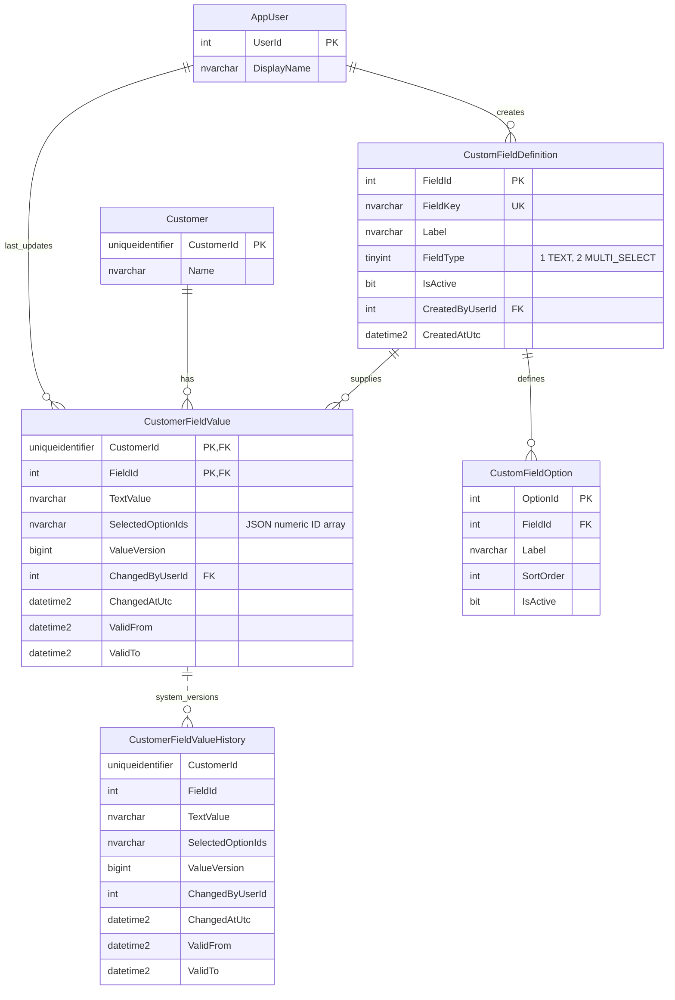

# Customer custom fields

This independent module implements part two of the ERP assignment. It shares a solution and SQL Server 2022 instance with discounts, but has its own database, API and four layered projects. Custom-field values are not connected to discount eligibility.

The dotted history relationship is conceptual: SQL Server manages the history table; it has no separate business primary key or foreign key to the current row. No application audit INSERT or trigger is used.

Definitions apply globally. Profiles begin from definitions and left-join one customer's values, so creating a definition requires no value-row prepopulation. A value row's composite key is (CustomerId,FieldId). User, field and option IDs are integer identities. Customer IDs are regular application-generated `Guid.NewGuid()` values stored as `uniqueidentifier`; no external generator is installed. The Customer primary key is clustered: random insertion locality is an accepted assignment tradeoff. Fixed seed GUIDs support repeatable samples.

FieldType is numeric in SQL (1=TEXT,2=MULTI_SELECT), with checked mapping to public TEXT/MULTI_SELECT names. Text values preserve case and nonempty whitespace; an empty string becomes NULL only after SQL verifies a TEXT field. Multi-select options are normalized rows, but a customer's complete selection is one canonical JSON array of unique ascending numeric IDs in NVARCHAR(4000). Ownership, integer type, duplicates, active status and bounds are enforced in the write procedure. The tradeoff is no FK inside JSON and less efficient cross-customer option filtering than a normalized junction table.

The definition lock precedes option access and the customer/value key-range lock. Value writes coordinate with metadata deactivation and serialize missing-key inserts. ExpectedVersion NULL means no value row is expected; a number must match an existing row before no-op detection. Missing expectedVersion is invalid JSON input. Stale submissions return409 even if they match the current value. No-op writes do not UPDATE, increment versions or produce temporal history. Every meaningful write is one short transaction and one insert/update. Write retries are deliberately absent because a response failure can occur after a successful commit.

History uses temporal current/history versions and LAG ordered by ValueVersion. Initial assignments appear as unset-to-value transitions; clearing retains prior versions. ChangedAtUtc is UTC operation time captured by SQL with DATETIME2(7) precision. Temporal ValidFrom/ValidTo represent transaction-begin time, not commit time. Neither timestamp promises exact physical-clock accuracy. The app never batches multiple meaningful updates to the same value into one transaction; temporal queries can omit zero-duration intermediate versions from such a batch.

Field/option soft deactivation preserves values and history. Previously selected inactive options can be retained, removed and displayed by stable labels, but not newly added. Field keys/types and existing option labels cannot be renamed through this API. Supporting historical labels after future renames would require temporal option metadata or label snapshots.

Development authentication supplies seeded actor1; outside Development that scheme supplies no identity and challenges401. Real ERP authentication is an integration seam. All API routes require authentication; actors never come from body/header data. The plain UI uses text-safe DOM operations for labels and values.
