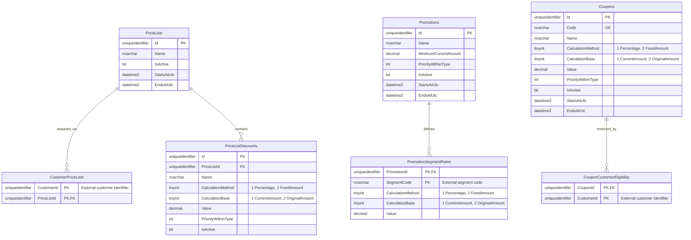

# Discounts

This module implements part one of the assignment in its own Domain, Application, Infrastructure and Api projects. It shares the solution and SQL Server 2022 instance with customer custom fields, but has a separate database. Customer-field values do not affect discount eligibility.

The API delegates calculation to Application's DiscountEngine. The engine calls category-specific providers, which depend on typed repository interfaces and the external customer-segment interface. Infrastructure implements stored-procedure reads, database-only row mappings, connection creation, read retries and the promotion cache. Domain owns immutable discount models and the pure calculator.

## ER diagram

[Open the standalone SVG diagram](er-diagram.svg). The diagram below represents the current SQL schema, rather than the historical assignment specification. SQL lengths, nullability and constraints are authoritative in [001_create_tables.sql](../../sql/discounts/001_create_tables.sql) and [002_create_indexes_and_types.sql](../../sql/discounts/002_create_indexes_and_types.sql).



Every relationship shown is an actual foreign key. CustomerPriceLists and CouponCustomerEligibility have composite primary keys; each assignment belongs to one PriceList or Coupon. A definition may have no assignments. PriceListDiscounts belongs to one PriceList. PromotionSegmentRates has one row per promotion/segment pair, containing that segment's complete calculation instruction. Coupons.Code is unique and normalized.

The [final SQL access-path review](../decisions/2026-11-10-sql-access-path-review.md) found the existing discount lookup indexes sufficient for the implemented queries. Customer/list, promotion/segment and coupon/customer composite keys match their predicates; the list-discount projection is covered and coupon codes are unique/indexed. Promotion refresh intentionally reads the full catalog, so active-flag or date-window indexes were not added speculatively.

CustomerId in the assignment tables is an opaque ERP customer identifier, not a foreign key to a locally owned Customer table or to the customer-fields database. SegmentCode is matched to the value returned by ICustomerSegmentProvider, not a foreign key to a segment table. No cross-module relationship is implied. The demo segment provider supplies fixed example values; it does not query custom fields.

An empty coupon customer allow-list means the coupon is unrestricted; once entries exist, the requesting customer must match one. Price-list discounts require an explicit customer assignment. The database stores no order, pricing result, central Discounts table or customer-segment profile. CouponCodeList is a table-valued parameter type, not a persisted entity, so it is not shown in the ER diagram.

All entity IDs and customer IDs are uniqueidentifier. Calculation enums are numeric TINYINT values. Discount values use DECIMAL(18,4), minimum amounts use DECIMAL(19,2), and nullable validity endpoints use UTC DATETIME2(3). CHECK constraints validate methods, bases, nonnegative values, percentage bounds and validity windows. Fixed amounts always use CurrentAmount by convention. These constraints replace the need for triggers.

## Design and trade-offs

- Domain contains immutable records and the pure calculator. Application contains request validation, engine, providers and typed repository interfaces. Infrastructure owns Dapper row DTOs/mappings and SQL connections. API owns DI, HTTP binding and error responses. Dependencies point inward.
- Providers run once in central priority order (100 PriceList, 200 Promotion, 300 Coupon), independent of DI/enum order. Same-category discounts sort by priority then ordinal ID; GUID IDs use lowercase D format. Each provider sees the remaining amount/history at category entry. Eligibility is not re-evaluated between discounts within a category; all eligible discounts stack.
- One injected TimeProvider sample supplies the price-list/coupon temporal queries and the C# promotion validity checks. Stored windows are nullable, UTC and half-open. Explicit DateTime2 parameters preserve query boundary instants; DATETIME2 columns store milliseconds. The promotion catalog query is independent of evaluation time. A common time does not provide a transactional database snapshot across provider reads, so concurrent administrative edits may affect different categories differently.
- Promotion resolution combines the segment supplied by ICustomerSegmentProvider with cached definitions/rates from the discount database. The same promotion resolves GOLD=10% and SILVER=5%; minimum 200 uses the stage-entry remaining amount. The repository uses two result sets selected coherently in the procedure. The provider evaluates active flags, time windows, segment and minimum amount on every request. Stored procedures do not calculate prices or order the cross-category pipeline.
- The calculator uses decimal, rounds each requested deduction to cents AwayFromZero and caps it at the remaining amount. A percentage can use original or current amount independently of execution order. Original 100, fixed 80, then 50% of original deducts only 20 and ends at zero. Fixed discounts report CurrentAmount with null calculationBaseAmount. Zero deductions remain in the breakdown.
- Order IDs remain nonblank strings limited to 64 characters. Customer IDs must be nonempty GUIDs; symbolic strings and numeric IDs are rejected. Original money must be nonnegative, numerically two-decimal EUR and fit DECIMAL(19,2), max 99999999999999999.99. The API validates the exact JSON numeric token before decimal conversion to prevent silent input rounding; equivalent trailing zeros and exponent notation remain accepted. Coupon codes trim, uppercase invariantly, deduplicate ordinally and allow 1–64 ASCII letters/digits/underscores/hyphens starting with a letter/digit. Null lists/elements fail; empty lists work. Request/history/result collections are defensive snapshots.
- Unknown/duplicate provider categories and malformed resolved discounts fail clearly. Missing categories are allowed by the reusable engine; the API registers all three. Duplicate discount IDs within a category fail; identities across different categories are independent. No per-request state is stored on the engine.
- There is no central Discounts table. PromotionSegmentRates owns the complete instruction: segment, CalculationMethod, Value and CalculationBase. A promotion's segments may use different calculation bases. Since method and base now live on the same row, a normal CHECK requires CurrentAmount for fixed amounts; no trigger is needed. Promotions retains shared eligibility, validity and priority. GUID identifiers and the (PromotionId,SegmentCode) key are unchanged.

Customer segmentation is external information behind Application's ICustomerSegmentProvider. The API registers an Infrastructure DummyCustomerSegmentProvider: 10000000-0000-4000-8000-019a6a000001 maps to GOLD, 10000000-0000-4000-8000-019a6a000002 to SILVER, 10000000-0000-4000-8000-019a6a000003 to BRONZE, and other IDs return no segment. These fixed demo assignments are isolated in that adapter; the application contains no customer classification logic and performs no segment database lookup. PromotionSegmentRates remains in SQL because promotion rates are discount rules. Replacing the dummy with another source requires implementing the same interface and changing DI registration; no external client is implemented here.

Local price-list assignments remain discount-domain facts with no external Customers FK. OrderId is correlation only. This assignment has no result persistence, coupon reservation/redemption, line allocations, tax/shipping, auth, external calls, message bus or background workers. Discount caching is limited to the promotion catalog described below. Production requirements would need a separate design rather than infrastructure added speculatively here.

This segment-provider boundary supersedes the original specification's local CustomerDiscountProfiles design by explicit user agreement; see [the scope decision](../../docs/decisions/2026-11-08-external-customer-segments.md). Provisioning scripts create no profile table or segment procedure and seed no profile assignments. As with other schema changes, use a fresh database containing the current schema.

The user also approved [moving calculation bases to promotion rates](../../docs/decisions/2026-11-08-promotion-rate-bases.md), replacing the original promotion-wide base and trigger design. The engine, calculator and public HTTP contract are unchanged.

## Promotion definition cache

The approved [cache decision](../../docs/decisions/2026-11-08-promotion-definition-cache.md) adds a small in-memory demonstration:

```text
PromotionDiscountProvider -> CachedPromotionRepository -> DapperPromotionRepository -> SQL Server
```

The API registers IMemoryCache and a singleton decorator. A hit returns an immutable catalog snapshot without querying SQL; a miss loads through the Dapper repository. An atomic compare-and-swap elects one loader per cache state; other readers asynchronously await a completion signal. CacheEntry contains no monitor locks or semaphores. Invalidation replaces the state and wakes waiting readers so they can load fresh data without waiting for a retired load. Empty successful catalogs are cached; failures and cancelled loads propagate and are not cached. Caller cancellation is also honored on cache hits. Each operation of the singleton Dapper repository opens/disposes its own connection; no SQL connection is retained across requests.

The catalog has a **60-second absolute expiration**, measured from successful loading. Hits do not extend its lifetime. Definition edits become visible on a subsequent refresh, eviction or application restart; each API process has its own cache. No invalidation endpoint, background refresh or distributed cache is implemented. The cache never stores PricingResult or resolved per-customer discounts. Price-list, coupon and segment lookups remain uncached.

The repository contract is GetDefinitionsAsync(CancellationToken), backed by dbo.usp_Promotion_GetDefinitions without an AsOfUtc parameter. The query returns all definitions and rate rows, including scheduled, expired and inactive candidates. Keeping their windows in the snapshot allows the provider to enforce start-inclusive/end-exclusive eligibility on each request even while the cache stays warm. Stage-entry amount and customer segment are evaluated each time too. Known time windows remain accurate; administrative changes to those windows/flags/rates can remain stale until refresh.

No settings are needed for the demonstration. Tests named CachedPromotionRepositoryTests advance the cache clock without sleeps to verify expiration, and cover concurrent misses, immutable snapshots, empty results, failure retry and cancellation. SQL-backed tests verify one catalog read across changing request contexts; HTTP tests update a rate and show that the running app retains its snapshot while a second app instance loads the new value.

The customer-field catalog uses the same cache-aside component and 60-second absolute expiration. Its singleton repository decorator directly owns the cache entries, matching the promotion decorator and sharing its state across requests. Successful definition creation, option creation and field/option activation changes invalidate both `includeInactive` variants. Older in-flight reads cannot repopulate invalidated entries. Customer-specific values, profiles and history remain uncached. Invalidation is local to one API process; see [the customer-field design](../../docs/customer-custom-fields/design.md) for consistency limits.

## Bounded SQL read retries

The three Dapper repositories share an Infrastructure SqlReadRetryPolicy using Polly.Core 8.4.2. One read gets an original attempt plus **at most two retries**, with 100ms exponential backoff, jitter and a maximum 500ms delay. An outer **five-second cooperative timeout** covers connection opening, command execution, materialization and retry delays. The supplied cancellation token is passed to connection opening and Dapper commands. Cancellation/cleanup can take additional driver time; this is not a hard real-time deadline.

The retry allow-list is deliberately narrow: SQL error 1205 (deadlock), 10928/10929 (resource limits), 40197/40613 (service interruption) and 40501 (service busy). Other SQL errors, malformed definitions, authentication/permissions/schema errors and command timeout -2 are not retried. Caller cancellation stops both active reads and retry delays. Exhaustion or budget expiry returns a failure, never an unchanged/partial price. No circuit breaker or Result-pattern conversion is added.

Each attempt creates fresh parameters/TVP and opens/disposes its own SqlConnection object; normal connection pooling remains enabled. SqlConnectionFactory forces ConnectRetryCount=0 to avoid multiplying the policy with driver reconnection retries. The engine and providers are not replayed: original customer/coupon inputs and AsOfUtc stay unchanged. Promotion cache hits still bypass SQL; uncached loads use the policy and failures are not cached. See [the retry decision](../../docs/decisions/2026-11-08-sql-read-retries.md).

No-SQL policy tests use a fake TimeProvider for the timeout. SQL tests inject real transient/permanent SqlException failures into procedures only in disposable test databases, verifying third-attempt recovery, exhaustion, one attempt on permanent errors, connection cleanup, cancellation, original timestamp preservation and an HTTP error after exhaustion. Production procedures remain read-only and unchanged.

Future discussion: a new category adds a provider/repository/tables and a priority-policy entry; external sources can sit behind a provider dependency. Per-line allocation, exclusive stacking, per-discount eligibility, multiple currencies, customer synchronization, result storage or message processing require explicit contract/policy redesign as described in the specification.

## Implementation record

The approved plan is [docs/superpowers/plans/2026-11-08-erp-discounts.md](../../docs/superpowers/plans/2026-11-08-erp-discounts.md); the supplied specification is preserved beside it under docs/superpowers/specs. Commits follow domain/calculator/engine, providers, Dapper, SQL, integration tests and API, with tests included in each increment.

The original implementation's SQL Server 2019 LocalDB runs are historical. The current modules target SQL Server 2022; current build, test, dependency-audit and live walkthrough results are recorded in [docs/verification.md](../../docs/verification.md). Prior references to engine failures or offline auditing there describe earlier development states, not the current result.

## SQL Server 2022 environment

Use a native SQL Server 2022 instance with Windows authentication, or set MSSQL_SA_PASSWORD in your shell/local ignored .env and run `docker compose up -d sqlserver`. For Docker, set SQLCMDPASSWORD to that password and deploy with `./sql/discounts/Deploy.ps1 -Server '127.0.0.1,1433' -UserName sa`. Override ConnectionStrings__Discounts and ERP_DISCOUNTS_TEST_CONNECTION with SQL-auth connection strings from your local environment. Never commit passwords. Both modules target engine 16 and compatibility 160; historical LocalDB2019 evidence does not verify the new target.
