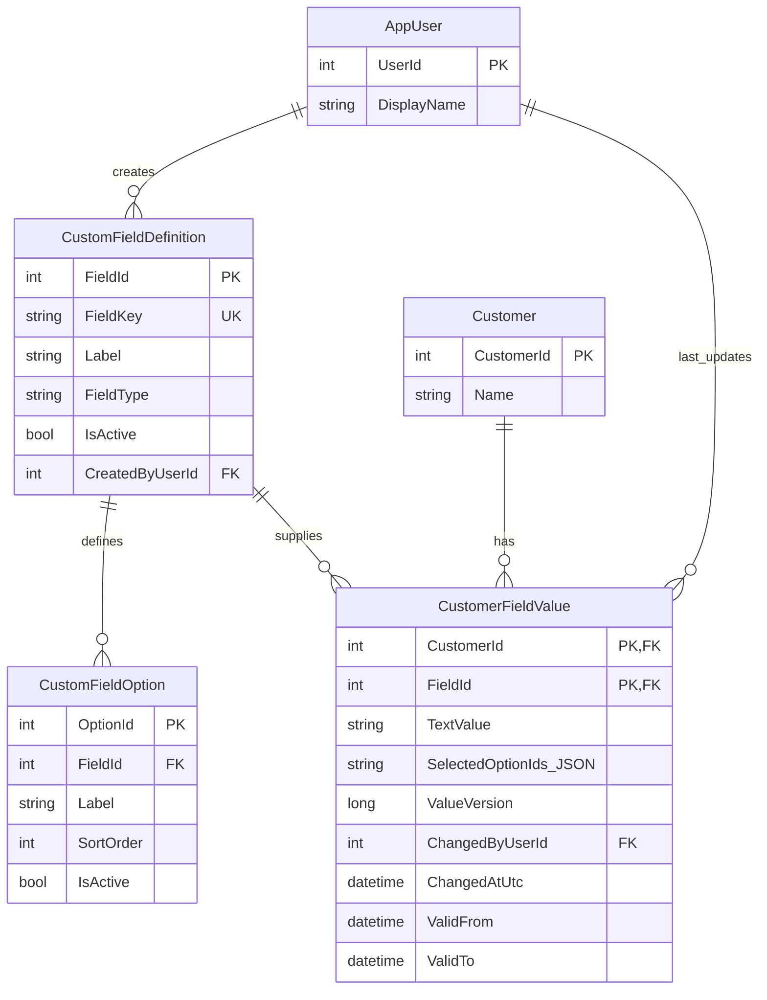

# ERP Assignment — Dynamic Customer Custom Fields

> **Purpose:** Implementation specification for Codex. Implement the requirements below as a small, executable, demonstrable project. This is an engineering assignment, not a production ERP. Optimize for correctness, clarity, testability, and defensible engineering decisions over extensive infrastructure.
>
> **Status:** Design decisions are approved. Implement without switching persistence approaches or adding unrelated infrastructure.

## 1. Problem statement

The ERP allows authenticated users to create custom fields for the `Customer` entity at runtime. A field can be either:

1. **Text**: a single free-text value.
2. **Multi-select**: a dropdown/list with multiple selectable options; one customer can select zero or more options.

Once a field definition is created, it must be available for **every customer profile**, including customers who existed before the field was created. A field's actual value belongs to a **specific customer**, not to the definition. Every meaningful change to a customer's value must have a retrievable history that shows consecutive **old -> new** values, the timestamp of the change, and the actor who made it.

Deliver an ER model **and** a runnable demonstration implementation.

## 2. Final technology and architecture decisions

| Topic | Decision |
|---|---|
| Application | .NET 10 / C# / ASP.NET Core Minimal API |
| Database | **SQL Server 2022** (16.x), database compatibility level suitable for SQL Server 2022 |
| Data access | **Dapper** with `Microsoft.Data.SqlClient` |
| Database management | Hand-written **SQL scripts** for schema and stored procedures; **no EF Core, no migrations** |
| Database interactions | **All application reads and writes through stored procedures**, executed with Dapper |
| Custom fields | Metadata-driven: field definitions are rows, **not runtime ALTER TABLE columns** |
| Selected options | JSON **array of numeric option IDs** in `NVARCHAR(4000)` |
| Historical values | SQL Server **system-versioned temporal table** for `CustomerFieldValue` |
| History semantics | Derive chronological old/new transitions from versions; no separate bespoke value-audit table |
| Updates | Stored procedure validates, compares canonical values, and updates atomically only if changed |
| Concurrency | Optimistic `ValueVersion` plus transaction/locking in the write procedure |
| Auth | Read actor ID from authenticated claims. For standalone demo, provide a **Development-only** fake principal; production auth integration remains a seam. Never trust a user ID sent in the body. |
| UI | Minimal functional demo page to create fields, display dynamic customer profiles, edit values, and inspect history. Avoid building a full ERP frontend. |

**Do not add:** RabbitMQ, Kafka, Redis, EF, generic repository abstractions, CQRS/MediatR framework, microservices, background workers, generic rule engines, multi-tenancy, rich-text controls, or unrelated features.

## 3. Core conceptual model



`CustomerFieldValue` is a **system-versioned temporal table** paired with a SQL Server-managed `CustomerFieldValueHistory` table (not an independently writable business entity). The composite `(CustomerId, FieldId)` key gives at most one current state per customer/field; previous states live in temporal history.

**Important:** `CustomFieldOption` contains the *available* options, not per-customer selections. Selections are stored as JSON **option IDs** in the value row. This is an intentional denormalization for atomic whole-set updates and straightforward temporal history.

## 4. Relational schema requirements

Use `dbo` for application tables (and an explicitly named history table, e.g. `history.CustomerFieldValueHistory`, if straightforward). Provide scripts in dependency order.

### 4.1 `Customer`

- `CustomerId INT IDENTITY PRIMARY KEY`
- `Name NVARCHAR(200) NOT NULL`
- Seed at least two customers.

### 4.2 `AppUser`

- `UserId INT IDENTITY PRIMARY KEY`
- `DisplayName NVARCHAR(200) NOT NULL`
- Seed at least one demo actor matching the development authentication principal.
- This is a stand-in for the existing ERP identity database, not a custom identity system.

### 4.3 `CustomFieldDefinition`

- `FieldId INT IDENTITY PRIMARY KEY`
- `FieldKey NVARCHAR(100) NOT NULL UNIQUE`: stable machine identifier, e.g. `customer_segments`.
- `Label NVARCHAR(200) NOT NULL`: display label.
- `FieldType VARCHAR(20) NOT NULL`: only `TEXT` and `MULTI_SELECT`, enforced by CHECK.
- `IsActive BIT NOT NULL DEFAULT 1`
- `CreatedByUserId INT NOT NULL` FK to `AppUser`
- `CreatedAtUtc DATETIME2(7) NOT NULL` (UTC)
- Optionally `MaxTextLength INT` if useful, but enforce a simple universal limit of **2000 characters** for text values.
- A field's type and key are **immutable** once created.

### 4.4 `CustomFieldOption`

- `OptionId INT IDENTITY PRIMARY KEY`
- `FieldId INT NOT NULL` FK to `CustomFieldDefinition`
- `Label NVARCHAR(200) NOT NULL`
- `SortOrder INT NOT NULL`
- `IsActive BIT NOT NULL DEFAULT 1`
- Index on `(FieldId, SortOrder, OptionId)`.
- Options are only valid for `MULTI_SELECT` fields.
- For the demo, support initial options and adding options. **Do not hard-delete options**, since historical values reference them by ID. Option deactivation is preferred.
- Do not rename existing option labels in this assignment. This preserves intelligible historical labels without needing to make option metadata temporal. Describe how temporal option definitions or label snapshots could support renames later.

### 4.5 `CustomerFieldValue` — **temporal**

Recommended shape (adjust details if necessary for valid SQL Server DDL):

```sql
CREATE TABLE dbo.CustomerFieldValue
(
    CustomerId INT NOT NULL,
    FieldId INT NOT NULL,
    TextValue NVARCHAR(2000) NULL,
    SelectedOptionIds NVARCHAR(4000) NULL,
    ValueVersion BIGINT NOT NULL,
    ChangedByUserId INT NOT NULL,
    ChangedAtUtc DATETIME2(7) NOT NULL,

    ValidFrom DATETIME2(7)
        GENERATED ALWAYS AS ROW START HIDDEN NOT NULL,
    ValidTo DATETIME2(7)
        GENERATED ALWAYS AS ROW END HIDDEN NOT NULL,
    PERIOD FOR SYSTEM_TIME (ValidFrom, ValidTo),

    CONSTRAINT PK_CustomerFieldValue
        PRIMARY KEY (CustomerId, FieldId),
    CONSTRAINT FK_CustomerFieldValue_Customer
        FOREIGN KEY (CustomerId) REFERENCES dbo.Customer(CustomerId),
    CONSTRAINT FK_CustomerFieldValue_Field
        FOREIGN KEY (FieldId) REFERENCES dbo.CustomFieldDefinition(FieldId),
    CONSTRAINT FK_CustomerFieldValue_User
        FOREIGN KEY (ChangedByUserId) REFERENCES dbo.AppUser(UserId),
    CONSTRAINT CK_CustomerFieldValue_Version
        CHECK (ValueVersion >= 1),
    CONSTRAINT CK_CustomerFieldValue_Json
        CHECK (SelectedOptionIds IS NULL
               OR ISJSON(SelectedOptionIds, ARRAY) = 1),
    CONSTRAINT CK_CustomerFieldValue_StorageShape
        CHECK (TextValue IS NULL OR SelectedOptionIds IS NULL)
)
WITH (SYSTEM_VERSIONING = ON
      (HISTORY_TABLE = history.CustomerFieldValueHistory));
```

Create the `history` schema first, or use `dbo.CustomerFieldValueHistory` consistently. Add sensible supporting indexes to support per-customer retrieval and per-field/per-customer history. **Do not use cascading FKs on the temporal current table**.

`ISJSON(..., ARRAY)` requires SQL Server 2022+ and checks array syntax only, not member types or uniqueness. The stored procedure must enforce JSON element validity, option ownership, and duplicates.

### 4.6 Data conventions

- Text field: `TextValue = 'something'` or `NULL`; `SelectedOptionIds = NULL`.
- Multi-select field: `TextValue = NULL`; `SelectedOptionIds = '[1,3]'` or `'[]'`.
- **No value row** means the customer has **never assigned a value** to the field.
- The API still returns all active definitions for every customer, even when no value row exists.
- First meaningful assignment **inserts** row with `ValueVersion = 1`; later changes **update** it and increment version.
- Clearing an existing text value updates it to `NULL`, and clearing an existing multi-select value updates to `[]` (history retained).
- Attempting to clear a never-set field is a **no-op** and does not create an empty row.
- Empty text `""` is treated as **unset** (`NULL`) by design; do **not** trim arbitrary nonempty text unless explicitly documented, as whitespace may be meaningful. For multi-select, `[]` is the empty selection.
- JSON arrays contain numeric **option IDs, not labels**, e.g. `[1,3]`, **not** `["VIP","Wholesale"]`, and never an object.
- Canonical serialization: unique ascending IDs, no semantic difference between `[3,1]` and `[1,3]`.
- `SelectedOptionIds` length bound is 4000 characters. Reject oversized lists with a clear validation error; do not silently truncate.
- Definition deactivation hides a field from normal profile editing but **must not remove old values or temporal history**. History remains retrievable by explicit field ID.

## 5. Required stored procedures

All data access from the app uses stored procedures, including reads; do not embed ad-hoc SQL in C#.

Suggested names and behaviors (adjust signatures for consistency, but retain semantics):

### Definitions and options

1. `dbo.CustomField_Create`
   - Input: key, label, type, creator user ID; for a multi-select field, supply initial options via JSON (or a separate procedure called transactionally).
   - Validate unique key, recognized type, nonblank labels, valid option list, and that a TEXT field has no options.
   - Create field + initial options in **one transaction**; return new ID/definition.
2. `dbo.CustomField_List`
   - Return fields (active only by default) and options, in a form straightforward for Dapper to map. Option lists should be ordered by `SortOrder, OptionId`.
3. `dbo.CustomField_AddOption`
   - Allowed for active multi-select fields only; return created option.
4. `dbo.CustomField_SetActive`
   - Soft deactivate/reactivate field; no value deletion.
5. `dbo.CustomField_SetOptionActive`
   - Soft deactivate/reactivate options; no physical deletion.
6. `dbo.Customer_List` and, if useful, `dbo.Customer_Get` for demo data.

### Per-customer values

7. `dbo.CustomerCustomField_ListForCustomer`
   - Input: customer ID.
   - Return **every active field definition**, its options, the customer's current value (if any), `ValueVersion` (nullable for not-yet-set), and last change details.
   - Use a `LEFT JOIN` from definitions to the customer's value rows, not the reverse.
   - No N+1 one-query-per-field implementation.
8. `dbo.CustomerCustomField_SetValue`
   - Input: `CustomerId`, `FieldId`, `TextValue`, `SelectedOptionIdsJson`, `ExpectedVersion` (nullable), `ActorUserId`.
   - This is the **sole writing path** for customer custom-field values.
   - Database-level validation, locking, no-op handling, and versioning are mandatory (see below).
   - Output the new/current value, version, timestamp, and whether anything changed.
9. `dbo.CustomerCustomField_GetHistory`
   - Input: customer ID, field ID.
   - Return **all transitions**, including initial unset -> first value, oldest to newest, with `OldTextValue`, `NewTextValue`, `OldSelectedOptionIds`, `NewSelectedOptionIds`, `ChangedAtUtc`, `ChangedByUserId`, and `ValueVersion`.
   - Derive from `CustomerFieldValue FOR SYSTEM_TIME ALL` using window functions such as `LAG` ordered by `ValueVersion`. Both the current row and temporal history must contribute. No separate manual audit INSERT.
   - When there has never been an assignment, return an empty list.
   - Do not rely on timestamp alone for ordering: use `ValueVersion` to order transitions deterministically.
   - Be aware that temporal point-in-time query semantics differ from enumerating **every** version if multiple writes occur within one transaction. Design one meaningful write per transaction and document this limitation.

### Set-value stored procedure — mandatory algorithm

Implement transactionally with `SET XACT_ABORT ON`, appropriate TRY/CATCH rollback, and a narrow locked critical section. Prefer `SERIALIZABLE` isolation or `UPDLOCK, HOLDLOCK` with a suitable unique key/index, so concurrent **first inserts** are serialized as well as existing-row updates.

1. Verify customer, field, and actor exist; ensure field is active.
2. Branch by authoritative `FieldType`, **never** by the client supplying `textValue` or `selectedOptionIds` alone:
   - TEXT: reject a supplied selection array; reject >2000 chars; canonicalize `""` -> `NULL`.
   - MULTI_SELECT: reject a supplied text value; require an array when assigning; canonicalize IDs to ascending unique integers. Validate JSON array, every item has JSON numeric/integer type, IDs fit `INT`, no duplicates, every option exists and belongs to the requested field. New selections must be active. Previously selected inactive options may remain selected if unchanged; do not permit newly adding inactive options.
3. Lock/read current `(CustomerId, FieldId)` state (or its missing-key range) in the same transaction.
4. Compare `ExpectedVersion` with stored version: `NULL` means caller expects no row; mismatch => concurrency conflict; **do not overwrite** or produce history. Check version before treating an attempted write as a no-op, so stale clients cannot hide lost updates.
5. Compare normalized semantic values. If unchanged, return `Changed=false`, original version/timestamp, **without issuing `UPDATE`**.
6. If no row and the requested value is empty/unset, return no-op with null version. Otherwise `INSERT` with version 1. For existing row and changed value, `UPDATE` once with `ValueVersion + 1`.
7. Set `ChangedAtUtc = SYSUTCDATETIME()` **in SQL Server** for the actual write and `ChangedByUserId = @ActorUserId`. Capture timestamp once per committed write path.
8. Commit. Return current result.

**Why no-op detection matters:** SQL Server creates a temporal history row on UPDATE even if column values do not change.

**Timestamp nuance:** `ValidFrom` / `ValidTo` are SQL Server-generated UTC timestamps reflecting the **start of the transaction**, not necessarily the exact UPDATE execution time (and not commit time). `ChangedAtUtc`, assigned by the update stored procedure, represents the database-observed **operation time** with `DATETIME2(7)` precision; it is not a guaranteed commit timestamp or a guarantee of absolute physical-clock accuracy. Use `ChangedAtUtc` for the requirement's change-time display and `ValueVersion` for exact transition order. This distinction belongs in the README/design notes.

## 6. Public HTTP API

Prefer route groups; document exact request and response JSON with sample calls in README. Suggested endpoints:

| Method | Route | Behavior |
|---|---|---|
| `GET` | `/api/custom-fields` | Global definitions with options |
| `POST` | `/api/custom-fields` | Create text or multi-select definition |
| `POST` | `/api/custom-fields/{fieldId:int}/options` | Add a dropdown option |
| `PATCH` | `/api/custom-fields/{fieldId:int}/active` | Soft activate/deactivate field |
| `PATCH` | `/api/custom-fields/{fieldId:int}/options/{optionId:int}/active` | Soft activate/deactivate option |
| `GET` | `/api/customers` | Seeded customers |
| `GET` | `/api/customers/{customerId:int}/custom-fields` | All active definitions plus this customer's values |
| `PUT` | `/api/customers/{customerId:int}/custom-fields/{fieldId:int}` | Set/clear customer-specific field value |
| `GET` | `/api/customers/{customerId:int}/custom-fields/{fieldId:int}/history` | Consecutive transitions and timestamps |

Example requests:

```json
POST /api/custom-fields
{
  "fieldKey": "customer_segments",
  "label": "Customer segments",
  "fieldType": "MULTI_SELECT",
  "options": [
    { "label": "VIP", "sortOrder": 1 },
    { "label": "Retail", "sortOrder": 2 },
    { "label": "Wholesale", "sortOrder": 3 }
  ]
}
```

```json
PUT /api/customers/1/custom-fields/3
{
  "textValue": null,
  "selectedOptionIds": [1, 3],
  "expectedVersion": null
}
```

```json
PUT /api/customers/1/custom-fields/3
{
  "textValue": null,
  "selectedOptionIds": [3, 2],
  "expectedVersion": 1
}
```

For `TEXT`, send `{ "textValue": "Gold account", "selectedOptionIds": null, "expectedVersion": null }`. For clearing an existing `MULTI_SELECT`, send `selectedOptionIds: []` with the latest expected version. **Require the `expectedVersion` property** for updates, but permit JSON `null` for the never-set state; distinguish missing from null in input validation.

The API returns arrays of numeric IDs as normal JSON arrays; the `NVARCHAR` JSON representation is a **database detail** and should not leak as an escaped JSON string.

History response example (illustrative):

```json
[
  {
    "valueVersion": 1,
    "oldValue": [],
    "newValue": [1, 3],
    "changedAtUtc": "2026-11-09T10:00:00.1234567Z",
    "changedByUserId": 1
  },
  {
    "valueVersion": 2,
    "oldValue": [1, 3],
    "newValue": [2, 3],
    "changedAtUtc": "2026-11-09T10:15:00.1234567Z",
    "changedByUserId": 1
  }
]
```

Use a discriminated value representation internally if it improves clarity (e.g. `FieldType` plus text/option IDs). Do not return an arbitrary union encoded inconsistently. It's acceptable for the API to return `{ oldTextValue, newTextValue, oldSelectedOptionIds, newSelectedOptionIds }` instead of `oldValue/newValue`, as long as it is documented and consistent.

HTTP behavior:

- `201 Created` for new field/option.
- `200 OK` for reads, updates, and no-op writes (with `changed` boolean).
- `400 Bad Request` / `422 Unprocessable Entity` for malformed input/invalid selections (choose one convention consistently).
- `401 Unauthorized` if no authenticated principal; `403 Forbidden` where authorization requires it.
- `404 Not Found` for missing customers/fields.
- `409 Conflict` for duplicate `FieldKey` or optimistic version conflicts.
- Use Problem Details, clear stable error codes, and central exception handling; **do not return raw SQL errors**.

### Authentication and authorization scope

The assignment says a **logged-in** user creates fields. Implement `RequireAuthorization()` on modifying endpoints (ideally reads too). Extract actor ID from a validated authenticated principal. For a self-contained demonstration, install a development-only fake authentication handler returning a seeded `UserId` so the page and tests run without a separate identity provider. It must be **disabled outside Development**, and documented as a demo substitute for ERP authentication. Never implement an unrestricted `X-UserId` client header in production. Do not accept `changedByUserId` from the request body.

## 7. Minimal demonstrator UI

Provide a basic page served by the application (plain HTML/CSS/JavaScript or a very light equivalent; avoid a heavyweight frontend architecture):

1. Display available customers; select customer A or B.
2. Create a custom TEXT field and a MULTI_SELECT field with initial options.
3. Automatically render active fields on **all** customer profiles:
   - TEXT => an input textbox.
   - MULTI_SELECT => a genuine multi-select control (native `<select multiple>` is sufficient, or accessible checkbox list if clearer).
4. Save a field's value independently for the selected customer, using the latest `ValueVersion` for optimistic concurrency.
5. Show change history for the selected customer/field: old value -> new value, actor, UTC timestamp.
6. Demonstrate that changing customer A does not change customer B, and that a newly created definition appears for both without pre-populating value rows.

No styling or user management beyond what's needed to prove the requirement.

## 8. Recommended project layout

```text
CustomerCustomFields/
  CustomerCustomFields.sln
  src/
    CustomerCustomFields.Api/
      Program.cs
      Endpoints/
      Contracts/
      Data/
      Services/            # only where coordination/validation merits it
      wwwroot/             # minimal demonstration UI
  tests/
    CustomerCustomFields.Tests/           # fast unit/HTTP tests
    CustomerCustomFields.IntegrationTests/ # real SQL Server tests
  database/
    001_schema.sql
    002_procedures.sql
    003_seed.sql
  docs/
    design.md              # ER diagram, decisions, trade-offs
  docker-compose.yml        # SQL Server 2022 for local dev
  README.md
```

Use direct and explicit dependencies; a focused `ICustomFieldRepository` or clearly named Dapper data-access classes are fine, but **do not build a generic repository framework**. Keep endpoint handlers thin, use dependency injection for data access, and use cancellation tokens.

### Local execution

Provide reproducible steps to:

1. Start SQL Server 2022 Developer with Docker Compose (`ACCEPT_EULA`, password via environment/config; no committed secret).
2. Run SQL schema / procedure / seed scripts (document `sqlcmd` or provide an automated bootstrap script that can handle `GO` batches).
3. Start the API with `dotnet run`.
4. Open the demonstration UI and explore the generated OpenAPI endpoint documentation (if enabled).
5. Run test suite with `dotnet test`.

No external cloud services should be required. Tests that require Docker may be a separate test category, with instructions. **A real SQL Server integration test is required**, because SQLite/InMemory substitutes cannot verify temporal tables and SQL Server stored procedures.

## 9. Tests — required acceptance cases

Write automated tests, emphasizing integration tests using real SQL Server:

### Definitions & visibility

- Create a TEXT definition and a MULTI_SELECT definition with options; they appear for **all** existing customers.
- A newly added customer sees the same field definitions with unset values.
- Creating a definition alone produces **zero** `CustomerFieldValue` rows.
- Reject duplicate `FieldKey` and invalid field types.
- Reject options on TEXT definitions.
- Inactive definitions do not appear in normal editing results, but previously stored values and history are preserved.

### Isolation & validation

- Customer A and B can assign different values to the same field without cross-contamination.
- Reject option IDs that do not exist or belong to another field.
- Reject duplicate IDs, strings, decimals, nulls, non-array JSON, and oversized selections.
- Reject selecting a newly inactive option; previously selected inactive options can be retained unchanged.
- Reject a text value assigned to MULTI_SELECT or option IDs assigned to TEXT.
- `[]` and `NULL` have the agreed empty-state semantics; clearing is properly versioned when it changes an existing value.

### History

- Initial assignment yields **version 1** history: unset -> chosen value.
- Two more writes yield versions 2 and 3 with the **correct consecutive old/new states**.
- A multi-select replacement `[1,3]` -> `[2,3]` is **one** temporal update and one history transition, not separate changes per option.
- `[3,1]` after `[1,3]` is a no-op: same version, **no new temporal record**.
- Writing the exact same text twice is a no-op: no new version/history.
- Clearing a previously assigned value preserves the earlier versions and produces a transition.
- Each transition has a non-null database-generated UTC `ChangedAtUtc` and user ID.
- `FOR SYSTEM_TIME AS OF` can reconstruct a previously committed value at a chosen point in time (use controlled sequential transactions/timestamps; do not assume transaction-start times are commit times).

### Concurrency

- Two writers submit the same expected version: only one write succeeds; the other receives `409`, with no lost update.
- Two writers simultaneously attempt the first assignment (`ExpectedVersion = null`): only one inserts; the other conflicts; no unique constraint race leaks as HTTP 500.
- Stale `ExpectedVersion` conflicts even if the submitted value happens to match the current one.

### Security & error handling

- Modifying endpoints require an authenticated principal.
- Request cannot impersonate a different actor through payload-supplied user ID.
- Missing customer/field returns `404`; invalid input returns a well-defined error (not a raw SQL exception).

## 10. Engineering notes and conscious trade-offs

### Temporal tables vs. explicit audit events

The requirement is **value history**, not a complete enterprise event-sourcing ledger. Temporal tables store complete versions of the customer-field state automatically, making this assignment smaller and easier to reason about. The history endpoint turns versions into consecutive value transitions using window functions. The initial version is an assignment from unset.

**Caveat:** SQL Server period times are transaction-begin times, not actual update or commit times. Provide a separate, database-generated `ChangedAtUtc`. Version number is the authoritative ordering. Multiple updates to the same row in one transaction can create zero-duration intermediate versions that point-in-time temporal queries do not expose normally; the application intentionally performs one customer-field change per short transaction.

### JSON selection IDs vs. normalized junction table

`CustomFieldOption` remains normalized, while one JSON array stores the selected ID set in the **single temporal row**. This enables atomic whole-value updates and makes the audited state unambiguous. Costs:

- No native FK constraint **inside the JSON array**: stored procedure must enforce validity.
- Filtering *all customers containing option X* is less naturally indexed than a relational junction table.
- JSON selections have an explicit length limit.

For this assignment, correctness of atomic selection changes and history matters more than cross-customer analytical filtering. If filtering/reporting becomes a first-class requirement, a normalized `CustomerFieldSelection` table, a separately maintained query projection, or carefully indexed JSON access paths could be evaluated.

### Option metadata/history

Option IDs remain stable. Soft-deactivate rather than delete. Metadata renaming history is not requested, and existing option labels cannot be renamed in the initial implementation. If the business later requires historical labels after renaming, consider temporalizing option definitions or recording label snapshots; do not silently display current labels as if they were historical labels.

### Avoid overengineering

This is a demonstrable ERP design exercise. Deliver a working, readable, well-tested vertical slice. Favor SQL constraints and contained stored-procedure validations over layers of abstractions. Explain realistic extensions in documentation, not speculative code.

## 11. Deliverables & definition of done

Codex should produce:

- [ ] Executable .NET 10 Minimal API project and minimal interactive UI.
- [ ] SQL Server 2022 database scripts including named temporal history table and procedures for **all** DB interactions.
- [ ] Dapper-only data access; no Entity Framework.
- [ ] ER diagram (Mermaid is acceptable) and short architecture/ADR explanation.
- [ ] Fully working create-definition, get-profiles, set-value, get-history flows.
- [ ] Demonstrably correct multi-select JSON canonicalization and validation.
- [ ] Database-enforced temporal versioning with `ChangedAtUtc`, actor ID, `ValueVersion`, no-op suppression, and concurrency handling.
- [ ] Real SQL Server integration tests and passing unit/HTTP tests.
- [ ] README with requirements, setup, test commands, examples, trade-offs, and demonstration walkthrough.
- [ ] No unrelated infrastructure or production-grade auth project.

**Implement and run the code and tests if the environment permits.** If SQL Server/Docker is unavailable, do not claim integration tests passed; report precisely which tests could be run and give reproducible commands. Do not stop at scaffolding or pseudocode.

## 12. Suggested demonstration walkthrough

1. Open customer A and B profiles (both initially show no custom fields).
2. Create `External Reference` (TEXT) and `Customer Segments` (MULTI_SELECT: VIP, Retail, Wholesale).
3. Open both profiles: **both fields appear** with unset values.
4. Set customer A reference to `ABC-123`; set customer B reference to `XYZ-999`.
5. Select `[VIP, Retail]` for A; later replace with `[VIP, Wholesale]`; verify B unchanged.
6. Open A's history: show unset -> `[VIP, Retail]` -> `[VIP, Wholesale]` with separate UTC timestamps and actor.
7. Save A's selection in the reverse input order; show `changed=false` and **no extra history**.
8. Simulate version conflict and show HTTP `409 Conflict` instead of silent overwrite.

## 13. Primary SQL Server references

- Temporal overview and exact transaction-start timestamp behavior: https://learn.microsoft.com/en-us/sql/relational-databases/tables/temporal/overview
- Creating a system-versioned temporal table: https://learn.microsoft.com/en-us/sql/relational-databases/tables/temporal/create
- Querying temporal data: https://learn.microsoft.com/en-us/sql/relational-databases/tables/temporal/query-data
- `ISJSON(..., ARRAY)` in SQL Server 2022: https://learn.microsoft.com/en-us/sql/t-sql/functions/isjson-transact-sql
- JSON in temporal tables: https://learn.microsoft.com/en-us/sql/relational-databases/json/json-data-sql-server
- Temporal limitations (including cascade restrictions): https://learn.microsoft.com/en-us/sql/relational-databases/tables/temporal/temporal-table-considerations-and-limitations
