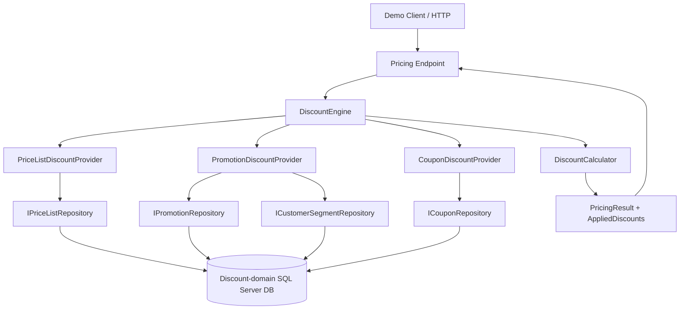

# ERP Discount Subsystem — Final Assignment Specification

**Status:** Agreed scope, ready for implementation with Codex  
**Target:** C# / .NET 10, SQL Server, Dapper, stored procedures, xUnit  
**Purpose:** Demonstrate sound domain design, SOLID principles, deterministic behavior, meaningful automated testing, and explainable trade-offs. This is a **technical assignment**, not a production system.

## 1. Problem statement

An ERP currently applies discounts inside an SQL stored procedure. Design a self-contained subsystem that accepts a `PricingRequest`, discovers all eligible discounts using **its own discount-domain database**, applies them in priority order, and returns a breakdown plus the final price.

**Fixed category priority:**

1. Price List
2. Promotion
3. Coupon

The system must support zero, one, or multiple discounts per category. Each category may determine eligibility and resolve its value using complex logic, queries, or (in a future integration) external services. Discounts support percentage and fixed-amount calculations. Calculation may be based on the original amount or the remaining amount, independently of the category's execution order.

**Illustrative acceptance example** (discounts all use the remaining amount):

| Step | Name | Method | Calculation base amount | Deduction | Remaining |
|---|---|---|---:|---:|---:|
| Initial | — | — | — | — | €340.00 |
| 1 | Gold Price List | 5% | €340.00 | €17.00 | €323.00 |
| 2 | Gold Promotion | 10% | €323.00 | €32.30 | €290.70 |
| 3 | WELCOME10 | Fixed €10.00 | n/a | €10.00 | **€280.70** |

`TotalDiscount = €59.30`.

## 2. Scope boundaries

### Implement

- A small executable **ASP.NET Core Minimal API** with a single pricing endpoint (`POST /api/pricing/calculate`). It is only a thin transport adapter; the discount engine has no HTTP dependencies.
- Core domain contracts, category providers, a deterministic `DiscountEngine`, a pure `DiscountCalculator`, and a `PricingResult` containing the full calculation breakdown.
- SQL Server schema and repeatable demo seed data, entirely through **SQL scripts**.
- **Dapper + Microsoft.Data.SqlClient + stored procedures for every runtime database operation**. No ad hoc SQL in C#.
- Price List, Promotion, and Coupon providers backed by repository abstractions.
- A promotion example whose **resolved discount value depends on customer segment**; this demonstrates the provider's ability to combine data and business rules rather than merely retrieve a static number.
- Unit tests for the calculator, engine, and providers; SQL integration tests where a SQL Server instance is available.
- A README describing setup, running, architecture decisions, limitations, and potential extensions.

### Explicitly do not implement

- Access to ERP `Orders` or `Customers` tables; cross-database joins; access to an external ERP database.
- RabbitMQ, message events, inbox/outbox, distributed transactions, background workers.
- Saving pricing results or order discount history; Redis or MongoDB (future possibilities only).
- Coupon redemption or reservation, inventory/stock checks, tax/shipping computation, payment, authentication, customer synchronization.
- Product-line allocations, advanced stacking/mutual-exclusion rules, configurable category priorities, external service integrations.
- EF Core, `DbContext`, EF migrations, runtime DDL, a rules-engine framework, MediatR/CQRS frameworks, or generic repository frameworks.

**Important:** Do not add infrastructure solely because this subsystem *could* later become a microservice. It is a self-contained capability with clean boundaries, not a distributed-systems demo.

## 3. Architecture



**The diagram is conceptual.** The engine executes providers sequentially by category priority and passes each resolved discount to the calculator. Providers are not processed globally in parallel because later categories can depend on earlier reductions.

### Architectural boundaries

- **Domain:** `ResolvedDiscount`, enums, calculation rules, applied-discount/result models. No SQL or HTTP.
- **Application:** `PricingRequest`, `PricingContext`, `IDiscountProvider`, `DiscountEngine`, provider orchestration, repository interfaces. No Dapper or SQL-specific types.
- **Infrastructure:** Dapper repositories, SQL row DTOs and mappings, concrete providers if preferred (or providers in Application using repository interfaces). No discount pipeline arithmetic.
- **API:** input binding/validation, dependency injection, invoking the application service, returning the result. No business calculations.

A provider owns **eligibility discovery and final discount value resolution**. The engine owns **ordering, invoking providers, applying the resolved results, and assembling the breakdown**. The calculator owns **money arithmetic, rounding, and capping**.

## 4. Contracts

These are intended names and shapes; implementation may add validation helpers without changing the architectural boundary.

```csharp
public enum DiscountType
{
    PriceList = 1,
    Promotion = 2,
    Coupon = 3
}

public enum CalculationMethod
{
    Percentage = 1,
    FixedAmount = 2
}

public enum CalculationBase
{
    CurrentAmount = 1,
    OriginalAmount = 2
}

public sealed record PricingRequest(
    string OrderId,
    string CustomerId,
    decimal OriginalAmount,
    string Currency,
    IReadOnlyList<string> CouponCodes);

public sealed record ResolvedDiscount(
    string Id,
    string Name,
    DiscountType Type,
    CalculationMethod CalculationMethod,
    decimal Value,
    int PriorityWithinType = 0,
    CalculationBase CalculationBase = CalculationBase.CurrentAmount);

public sealed record PricingContext(
    PricingRequest Request,
    decimal CurrentAmount,
    IReadOnlyList<AppliedDiscount> AppliedDiscounts,
    DateTimeOffset AsOfUtc);

public sealed record AppliedDiscount(
    int Sequence,
    string DiscountId,
    string Name,
    DiscountType Type,
    CalculationMethod CalculationMethod,
    CalculationBase CalculationBase,
    decimal Value,
    decimal? CalculationBaseAmount,
    decimal PriceBefore,
    decimal DiscountAmount,
    decimal PriceAfter);

public sealed record PricingResult(
    string OrderId,
    string Currency,
    decimal OriginalAmount,
    decimal TotalDiscount,
    decimal FinalAmount,
    IReadOnlyList<AppliedDiscount> Discounts);

public interface IDiscountProvider
{
    DiscountType Type { get; }

    Task<IReadOnlyList<ResolvedDiscount>> GetEligibleAsync(
        PricingContext context,
        CancellationToken cancellationToken);
}

public interface IDiscountEngine
{
    Task<PricingResult> CalculateAsync(
        PricingRequest request,
        CancellationToken cancellationToken);
}
```

**Names are deliberate:** use `CalculationMethod`, not `DiscountValueType`; use `ResolvedDiscount`, not a SQL entity called `Discount`.

**`OrderId` is an opaque correlation identifier**, not a database lookup key. The service does not own order rows. The request provides order-specific facts (amount, customer ID, requested coupon codes). The service's domain tables determine discount eligibility. Customer identifiers stored in local assignment tables are demo discount-domain facts, not foreign keys to an ERP customer table.

The current assignment operates on a **single discountable order amount**, not individual order lines. Product IDs and line-level allocation can be discussed as an extension rather than introducing half-implemented line models.

## 5. Discount engine semantics

1. Validate the request (nonblank IDs, nonnegative original amount, supported currency, valid coupon codes). For this exercise support **EUR only**, with two fractional digits.
2. Sample evaluation time **once** using an injected `TimeProvider` and reuse `AsOfUtc` for all provider queries.
3. Initialize `current = request.OriginalAmount` and an empty list of applied discounts.
4. Obtain registered providers and order them using a central policy: `PriceList = 100`, `Promotion = 200`, `Coupon = 300`. Do **not** rely on dependency-injection registration order or the numeric enum values. Reject duplicate provider categories and unknown category priorities.
5. At the start of each category, construct a `PricingContext` containing the original request, **current stage-entry amount**, applied discounts so far and evaluation timestamp.
6. Invoke that provider **once per category**, retrieve zero or more fully resolved eligible discounts, validate that their `Type` matches the provider, and order them by `PriorityWithinType`, then stable `Id` (ordinal comparison).
7. Apply the discounts sequentially through the calculator. Add an `AppliedDiscount` for each with global sequence, calculation base amount, actual deducted amount and before/after prices.
8. Return `PricingResult`; **do not persist or cache it**.

### Chosen stacking assumption

All eligible discounts stack. **Eligibility is evaluated once at entry to each category**, not after every discount within that category. This is a deliberate simplification; per-discount re-evaluation and mutual exclusion are future extensions. Distinct categories can make eligibility decisions using the amount remaining after previous categories.

### Calculation rules

For discount `d` and current amount `current`:

```text
calculationBaseAmount =
    OriginalAmount, if d.CalculationBase == OriginalAmount
    current,        if d.CalculationBase == CurrentAmount

requestedDeduction =
    calculationBaseAmount * d.Value / 100, if Percentage
    d.Value,                              if FixedAmount

roundedDeduction = Round(requestedDeduction, 2, AwayFromZero)
appliedDeduction = Min(current, roundedDeduction)
priceAfter = current - appliedDeduction
```

- Use C# `decimal` (not `double`).
- Reject invalid `CalculationMethod`, `CalculationBase`, negative values, percentages above 100, and malformed provider results. Unknown values must not be silently ignored.
- Always cap deductions at the remaining price, including for `OriginalAmount`-based percentages. No negative final prices.
- For fixed-amount discounts, treat `CalculationBase` as `CurrentAmount` by convention; `CalculationBaseAmount` in the output is `null` because no percentage base was used.
- `TotalDiscount` equals `OriginalAmount - FinalAmount` and equals the sum of applied `DiscountAmount` values.
- Prefer an explicit result from the calculator such as `(CalculationBaseAmount, AppliedAmount, PriceAfter)`; keep the calculator pure and simple. An `IDiscountCalculator` interface is optional, not required just for mocking.

### Independent calculation base example

A 10% promotion executing after the Price List discount can still use `OriginalAmount` as its calculation base:

| Sequence | Discount | Base | Applied deduction | Remaining |
|---:|---|---:|---:|---:|
| Start | — | — | — | €340.00 |
| 1 | Price List 5% | €340.00 | €17.00 | €323.00 |
| 2 | Promotion 10%, OriginalAmount | €340.00 | €34.00 | €289.00 |
| 3 | Coupon €10 | n/a | €10.00 | **€279.00** |

Also test a capped discount: original €100, first discount €80 fixed, then 50% of original (€50 requested) while only €20 remains. The second discount applies **€20**, final **€0**.

## 6. Eligibility design

Each provider may perform **multiple database operations and compose the returned domain data**, or eventually call external services. The engine knows nothing about these operations.

### Price List provider

- Retrieve active Price Lists assigned to the supplied `CustomerId` and their definitions through an `IPriceListRepository`.
- Return zero or many `ResolvedDiscount` values, with `Type = PriceList`.
- Discount values come from discount definitions, not the API request.

### Promotion provider — deliberately nontrivial

- Call `ICustomerSegmentRepository` to retrieve the customer's discount segment from the service-owned domain table.
- Call `IPromotionRepository` for active promotion definitions and their per-segment rates.
- Determine eligibility in **C#** using stage-entry `CurrentAmount`, `MinimumCurrentAmount`, the customer's segment, validity and rate rows returned by the repository.
- Resolve the final percentage/fixed amount **dynamically** from `PromotionSegmentRates`, and return eligible `ResolvedDiscount` values.
- Seed `GOLD = 10%`, `SILVER = 5%` for the same promotion. This demonstrates that providers can coordinate multiple sources and calculate the final discount value. We intentionally do not implement an external HTTP client.

### Coupon provider

- Normalize supplied codes (trim, uppercase invariant, distinct); require safe lengths and reject malformed codes.
- Use `ICouponRepository` to query eligible active coupon definitions, respecting optional customer restrictions.
- Return zero or many `ResolvedDiscount` values, with `Type = Coupon`.
- Looking up/using a coupon in a pricing calculation does **not** redeem it.

**Database access boundary:** Repositories execute stored procedures via Dapper; providers map rows/read models to domain `ResolvedDiscount` objects and own eligibility/resolution workflow. A stored procedure may efficiently join/filter SQL data, but must **not** implement cross-category ordering or final monetary calculation.

## 7. SQL Server persistence model

There is **no central mandatory `Discounts` table**. Each provider owns a set of domain tables. All tables live in one service-owned SQL Server database for the assignment.

| Table | Essential fields / meaning |
|---|---|
| `PriceLists` | `Id`, `Name`, `IsActive`, `StartsAtUtc`, `EndsAtUtc` |
| `CustomerPriceLists` | `(CustomerId, PriceListId)` assignment; no FK to an external Customers table |
| `PriceListDiscounts` | `Id`, `PriceListId`, `Name`, `CalculationMethod`, `CalculationBase`, `Value`, `PriorityWithinType`, `IsActive` |
| `CustomerDiscountProfiles` | `CustomerId` (PK), `SegmentCode` e.g. GOLD/SILVER; demo-only customer discount-domain data |
| `Promotions` | `Id`, `Name`, `CalculationBase`, `MinimumCurrentAmount`, `PriorityWithinType`, `IsActive`, `StartsAtUtc`, `EndsAtUtc` |
| `PromotionSegmentRates` | `(PromotionId, SegmentCode)`, `CalculationMethod`, `Value` |
| `Coupons` | `Id`, `Code` (normalized unique), `Name`, `CalculationMethod`, `CalculationBase`, `Value`, `PriorityWithinType`, `IsActive`, `StartsAtUtc`, `EndsAtUtc` |
| `CouponCustomerEligibility` | `(CouponId, CustomerId)` optional allow-list; no rows means unrestricted |

**Required constraints:**

- SQL Server `UNIQUEIDENTIFIER` for definition IDs; `NVARCHAR(64)` for opaque `CustomerId` and coupon code; `DECIMAL(18,4)` for definition values; `DECIMAL(19,2)` for money amounts; datetime columns stored as UTC `DATETIME2(3)`.
- Nonnegative discount values; percentage values at most 100; `CalculationMethod` limited to `Percentage` or `FixedAmount`; `CalculationBase` limited to `CurrentAmount` or `OriginalAmount`.
- For fixed-amount definitions require `CalculationBase = 'CurrentAmount'` by convention.
- UTC validity interval `[StartsAtUtc, EndsAtUtc)` where bounds are nullable. Enforce valid date ranges. Pass `AsOfUtc` to every read SP rather than calling `GETUTCDATE()` independently across providers.
- Proper primary keys, internal foreign keys and useful indexes; unique normalized coupon code.
- No `Orders`, `OrderAppliedDiscounts`, `CouponRedemptions`, inbox/outbox or result storage tables.

### SQL deliverables

```text
sql/
  000_create_database.sql
  001_create_tables.sql
  002_create_indexes_and_types.sql
  003_create_stored_procedures.sql
  004_seed_demo_data.sql
```

Scripts must be executable in a documented order via SSMS or `sqlcmd`. Use `CREATE OR ALTER PROCEDURE`, valid `GO` boundaries and clear database context. Seed scripts should be repeatable or clearly labeled as one-time setup. Only SQL scripts create schema/database objects; the application must not execute DDL.

### Stored-procedure-only runtime access

| Stored procedure | Input | Returns / purpose |
|---|---|---|
| `dbo.usp_PriceList_GetEligible` | `@CustomerId`, `@AsOfUtc` | Assigned active list discounts, including calculation method/base/value/priority |
| `dbo.usp_CustomerDiscountProfile_GetSegment` | `@CustomerId` | Segment code or none |
| `dbo.usp_Promotion_GetActiveDefinitions` | `@AsOfUtc` | Active definitions, minimum amount, and per-segment rates; can return multiple rate rows per promotion |
| `dbo.usp_Coupon_GetEligible` | `@CustomerId`, `@Codes dbo.CouponCodeList READONLY`, `@AsOfUtc` | Matching active coupons with optional customer eligibility |

Repositories should expose typed method results (`PriceListDefinition`, `PromotionDefinition` plus segment-rate rows, `CouponDefinition`, etc.) and explicitly validate/marshal stored procedure strings to enums. The application must not reuse Dapper DTOs as domain models. The promotion repository may use `QueryMultiple` or a multi-row projection to return promotion definitions and rates coherently. Query complexity belongs in procedures/repositories; final eligibility composition stays in C#.

All C# database access uses the following *pattern*:

```csharp
var command = new CommandDefinition(
    "dbo.usp_Promotion_GetActiveDefinitions",
    parameters: new { AsOfUtc = context.AsOfUtc.UtcDateTime },
    commandType: CommandType.StoredProcedure,
    cancellationToken: cancellationToken);

var rows = await connection.QueryAsync<PromotionRow>(command);
```

Use `Microsoft.Data.SqlClient`, parameterized stored procedure calls, and `await using` for connections. For coupon lists use a SQL Server **table-valued parameter** (`dbo.CouponCodeList`) rather than concatenated SQL text. Do not use EF, Dapper.Contrib, inline `SELECT` statements in C#, or repository methods returning live SQL connections.

## 8. API contract and demo

Provide `POST /api/pricing/calculate` accepting JSON equivalent to:

```json
{
  "orderId": "ORD-123",
  "customerId": "customer-001",
  "originalAmount": 340.00,
  "currency": "EUR",
  "couponCodes": ["WELCOME10"]
}
```

The result must include `orderId`, `currency`, `originalAmount`, `totalDiscount`, `finalAmount`, and three ordered discount results with `sequence`, `discountId`, `name`, `type`, `calculationMethod`, `calculationBase`, `value`, `calculationBaseAmount`, `priceBefore`, `discountAmount`, and `priceAfter`.

**Seed requirements:**

1. `customer-001` is assigned one active price list granting **5%**, using `CurrentAmount`.
2. Its segment is `GOLD`; one active promotion provides **10%** for GOLD and **5%** for SILVER, minimum current amount €200, using `CurrentAmount`.
3. `WELCOME10` is an active eligible **€10 fixed** coupon.
4. The sample request yields exactly three discounts and **€280.70** final amount.
5. Seed additional customer(s), promotions and/or coupons as needed to demonstrate zero/multiple eligibility and deterministic ordering, without changing the primary demo's expected result.

Keep the API thin: validation errors produce a clear 400 response, missing discounts produce 200 with an empty list, and database failures must be surfaced as failures, **not** silently converted into an unchanged price.

## 9. Tests and definition of done

### Unit tests (must not need SQL Server)

- Calculator: CurrentAmount percentage, OriginalAmount percentage, fixed amount, monetary rounding, over-discount capping, invalid values, zero amounts.
- Engine: priority regardless of provider registration order; sample result **€280.70**; OriginalAmount variant **€279.00**; multiple discounts in the same category ordered by priority and ID; empty eligibility; current stage state passed to next provider; category/type mismatch; duplicate providers; consistent totals.
- Providers: eligibility and dynamic value resolution using fake/mock repository implementations (e.g. GOLD vs SILVER promotion rates); promotion minimum applied to stage-entry price; coupon normalization; returning zero or multiple resolved discounts; propagation of persistence exceptions.

### Integration tests (SQL Server required; may be opt-in)

- Execute scripts against a disposable/test SQL Server database, then invoke every real stored procedure via Dapper.
- Validate customer/list joining and active windows; customer-segment retrieval and promotion rates; coupon TVP and optional allow-list; mapping of nullable/time/enum columns; multiple returned discounts.
- Unit-test suite must run without SQL Server. Do not replace SQL Server integration tests with SQLite/EF because the stored procedure behavior is provider-specific.

### Completion checklist

- [ ] `.NET 10` solution builds; unit tests pass.
- [ ] Database can be created entirely from supplied SQL scripts and seeded with sample data.
- [ ] Every runtime database call uses **Dapper + a stored procedure**.
- [ ] `POST /api/pricing/calculate` returns **€280.70** and a correct breakdown for the demo input.
- [ ] Engine/calculator have no infrastructure dependencies; providers can be unit tested in isolation.
- [ ] No ERP Orders access, no EF, no message bus, no result persistence.
- [ ] README has a setup guide, request/response example, decisions/trade-offs and future directions.

**Do not claim successful execution without actually running build and tests.** If SQL Server is unavailable, state which integration tests were not executed.

## 10. Suggested solution layout

```text
ERP.Discounts/
├── ERP.Discounts.sln
├── src/
│   ├── ERP.Discounts.Domain/
│   │   └── Models, Enums, DiscountCalculator
│   ├── ERP.Discounts.Application/
│   │   └── DiscountEngine, Providers, Contracts, Repository abstractions
│   ├── ERP.Discounts.Infrastructure/
│   │   └── Dapper repositories, SQL row DTOs, mappings, DI setup
│   └── ERP.Discounts.Api/
│       └── Minimal API endpoint, Program.cs, appsettings.json
├── tests/
│   ├── ERP.Discounts.UnitTests/
│   └── ERP.Discounts.IntegrationTests/       # opt-in with SQL Server
├── sql/
│   └── 000..004 .sql scripts
├── samples/
│   └── pricing.http
└── README.md
```

These layers keep persistence replaceable without building a framework. If desired, implementation may combine Domain and Application into one `Core` project, provided dependencies still point inward and unit tests stay infrastructure-free.

## 11. Architecture decisions and rationale (for discussion)

| Decision | Why | Cost / limitation |
|---|---|---|
| Provider-based architecture | Each category has independent eligibility and value-resolution logic; add a category without rewriting engine's loop | Register provider and update the central category-priority policy |
| Resolved discount separated from SQL definition | Complex mechanisms can emit a consistent instruction to the calculator | Small mapping layer |
| Central sequential engine | Makes priority, compounding and result ordering explicit and testable | No cross-category parallel evaluation; this is intentional |
| Pure centralized calculator | One consistent place for percentage/fixed arithmetic, rounding, original/current base and nonnegative cap | More elaborate money/line models would need extensions |
| Explicit `CalculationBase` | Calculation base is independent of application order; easy to demonstrate original-price discounts | Only two bases supported for the assignment |
| Dapper + stored procedures | Required SQL Server access approach; explicit DB contracts, no EF | SQL schema/procedure tests and mapping upkeep are important |
| Category-specific tables, no central `Discounts` table | Eligibility and data shape differ by type | Common administration/reporting would need another abstraction |
| No result persistence | Calculation returns a value, avoids unnecessary side effects | No audit history or caching |
| Minimal API, no messaging | Executable demonstration without infrastructure distractions | Does not demonstrate asynchronous message processing |

## 12. Future evolution — discussion only

These are *not* promises of effortless change; identify what stays stable and what needs redesign.

- **New category** (e.g. Loyalty): add a provider/repository/tables and add the priority rule; engine's main loop and calculator remain unchanged.
- **External services:** add a typed client abstraction to a provider; tests use a fake, engine unchanged. Consider timeout/retry/circuit breaking if actually deployed.
- **Per-line/product discounts:** extend request/result with line identity and eligible amounts and redesign the allocation model; not simply another `CalculationBase` enum value.
- **Exclusive/conditional stacking:** introduce an explicit stacking/group-selection policy; current assumption is that every eligible discount applies.
- **Eligibility depending on each prior discount:** evolve the provider contract to resolve per discount, rather than once per category.
- **Dynamic category priorities:** replace the fixed policy with validated configuration, keeping ordering centralized.
- **Currency support:** introduce currency precision and rounding policies; do not assume every currency has two decimals.
- **Persistence/cache:** attach a result-store or cache at the application boundary (Redis for short-lived caching; MongoDB or relational storage if durable history is required). Do not add writes to the pure engine.
- **Message-driven processing:** wrap the same application service behind a consumer/publisher adapter and design idempotency/outbox only when RabbitMQ is actually in scope.
- **Authoritative customer data:** the seeded local `CustomerDiscountProfiles` / price-list assignments are an assignment simplification. In a deployed environment, define data ownership and synchronization explicitly.

## 13. Codex instructions

**Suggested implementation order:**

1. Create solution and core contracts/engine/calculator.
2. Write calculator and engine unit tests (including €280.70 / €279.00 and priority guarantees).
3. Implement category providers and tests using fake repositories.
4. Create SQL scripts and seed the demo data.
5. Implement Dapper repositories + stored procedure calls + mappings.
6. Wire up the Minimal API and provide `samples/pricing.http`.
7. Run build and tests, document how to run the SQL-backed demo, finish README/ADRs.

**Prompt to give Codex together with this file:**

> Implement the assignment described in `ERP_Discount_Assignment_Final_Spec.md`. Treat this document as the implementation contract. Use .NET 10, SQL Server, Dapper, stored procedures for every runtime DB interaction, and SQL scripts for database creation/seeding. Keep the core engine free of SQL/HTTP. Implement the Price List, Promotion and Coupon providers; demonstrate nontrivial promotion resolution by customer segment. Enforce priority and calculation semantics, including `CalculationMethod` and `CalculationBase`. Build the Minimal API and tests and verify the €280.70 sample. Do not add EF Core, RabbitMQ, Redis, MongoDB, Orders-table access, output persistence, or other production-only infrastructure. Make pragmatic assumptions where required and document them rather than expanding scope.
